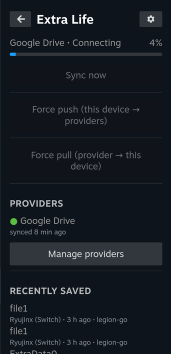
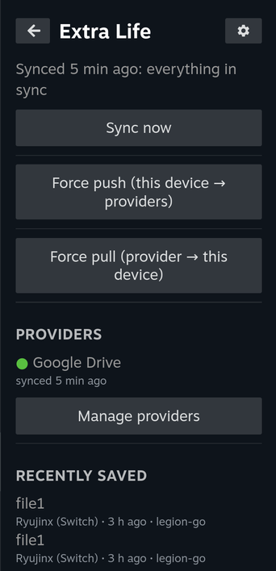
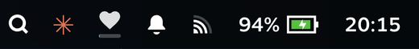
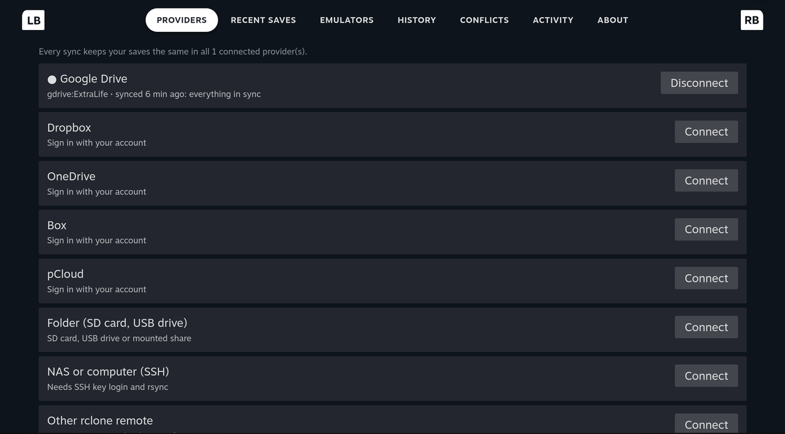
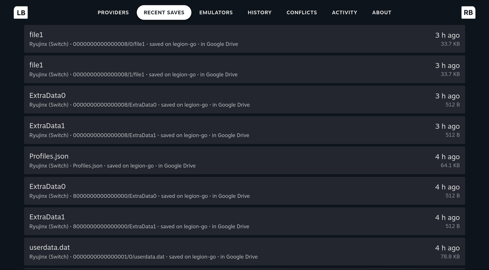
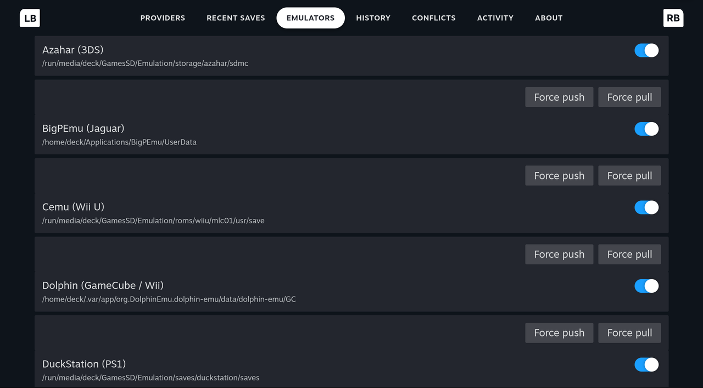
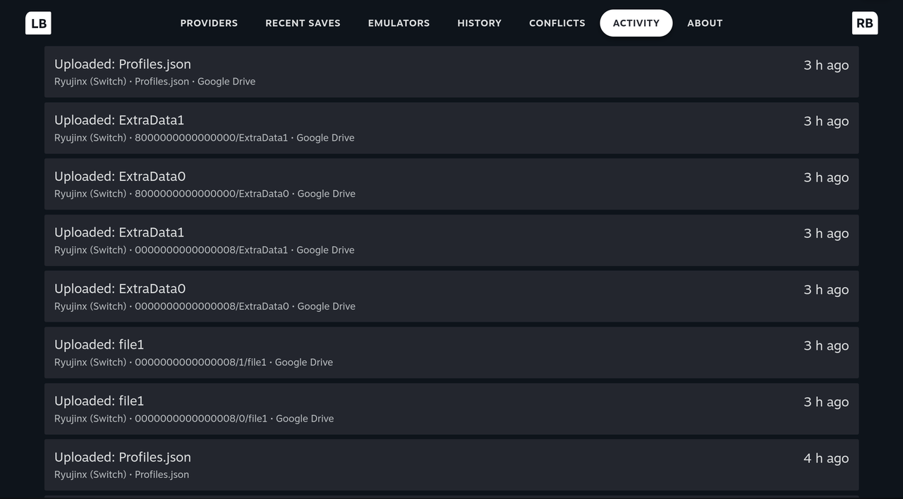
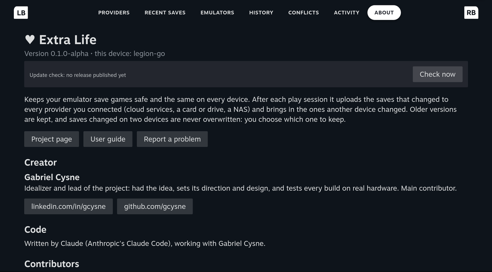

# Extra Life

Keep your emulator save games safe and in sync across handhelds and PCs. After every play session, Extra Life
uploads the saves that changed to the cloud service or disk you choose, and brings in the ones another device
changed. Nothing is ever overwritten silently: older versions are kept, and saves changed on two devices are
flagged for you to decide.

Built for SteamOS handhelds (Steam Deck, Legion Go, ROG Ally...) with a Decky Loader panel for Game Mode, but the
command and the background service work on any Linux PC.

> Alpha: back up your saves before trying it.

## Features

- **Several providers at once:** Google Drive, Dropbox, OneDrive, Box and pCloud (sign in from Game Mode), a folder
  (SD card, USB drive, mounted share), a NAS or computer over SSH, or any other [rclone](https://rclone.org) remote
  (S3, WebDAV/Nextcloud, Mega...). Every sync keeps all connected providers the same; connect and disconnect them
  at any time.
- **Automatic:** syncs when a game closes (Decky plugin). Optional: also after boot and every 30 minutes (off by
  default; a toggle in the plugin).
- **Safe:** compares every file with the last synced state, so it knows which side changed. Saves changed on two
  devices become conflicts, not overwrites. Replaced versions stay in the remote's history (30 days by default) and
  in a local backup folder. Never pulls into a running emulator.
- **Game Mode panel:** sync progress (also as a ♥ icon in Steam's status bar while a sync runs), providers, recently
  saved games, sync now, force push and force pull (all or per emulator), browse history and restore an older
  version, resolve conflicts.
- **20 emulators** out of the box (EmuDeck layout first, then Flatpak and native defaults): RetroArch, Dolphin,
  Ryujinx, PPSSPP, DuckStation, PCSX2, RPCS3, Cemu, Azahar, melonDS, mGBA, RMG, Vita3K, shadPS4, xemu, Xenia,
  Flycast, ScummVM, MAME, BigPEmu. Add your own in a few lines ([docs/profiles.md](docs/profiles.md)).
- Save files only. Save states are optional (off by default); keys, firmware, BIOS, DLC and updates are never
  uploaded.

## Screenshots

<p>

&nbsp;

</p>

The ♥ icon in Steam's status bar while a sync runs (it disappears when the sync ends):



The ⚙ cog opens the full page:

| Providers | Recent saves |
|---|---|
|  |  |
| **Emulators** | **Activity** |
|  |  |
| **About** | |
|  | |

## Requirements

- SteamOS 3.7+ (Steam Deck, Legion Go, ROG Ally...) or another Linux with systemd and Python 3.11+.
- [Decky Loader](https://decky.xyz) for the Game Mode panel (optional: without it you use the `extralife` command).
- Installed for you when needed: [rclone](https://rclone.org) for cloud providers (official build, checksum
  verified, `~/.local/share/extra-life/bin`) and, only to build the plugin, Node.js (official build, checksum
  verified, `~/.cache/extra-life/node`). `git`, `python3`, `rsync` and `curl` ship with SteamOS.

## Install

In **Desktop Mode**, open Konsole and run **one** of these:

**From the latest release** (recommended: a tested version, the Decky plugin comes prebuilt, nothing else to
download):

```bash
curl -fsSL https://github.com/gcysne/extra-life/releases/latest/download/get-release.sh | bash
```

It downloads `extra-life.tar.gz` from the latest [release](https://github.com/gcysne/extra-life/releases), checks
it against the release's `SHA256SUMS`, and runs its installer. Nothing is left behind but the installed program.

**From the source code** (latest development version, kept as a git clone you can update and contribute from):

```bash
curl -fsSL https://raw.githubusercontent.com/gcysne/extra-life/main/get.sh | bash
```

It clones Extra Life into `~/extra-life` and runs its installer (the first time it also downloads Node.js to build
the plugin). Prefer to read before running? Same thing by hand:

```bash
git clone https://github.com/gcysne/extra-life.git ~/extra-life
cd ~/extra-life
./install.sh
```

The installer asks for your password **once**, only to copy the plugin into Decky's folder (`~/homebrew/plugins`
belongs to root). Everything else goes in your home folder, so it survives SteamOS updates:

| What | Where |
|---|---|
| Program and emulator profiles | `~/.local/lib/extra-life/` |
| `extralife` command | `~/.local/bin/extralife` |
| Background sync (systemd user service; the 30-minute timer is installed **off**) | `~/.config/systemd/user/extralife-sync.{service,timer}` |
| Decky plugin | `~/homebrew/plugins/extra-life/` |
| Settings and cloud sign-ins (created when you connect a provider) | `~/.config/extra-life/` |
| Sync state, local backups of replaced saves, activity log | `~/.local/state/extra-life/` |

Options: `--no-plugin` (command and service only). With a one-liner: `... | bash -s -- --no-plugin`.

**Or let Claude do it.** If you use Claude Code (for example through [Sidequest](https://github.com/gcysne/sidequest)),
give it this prompt:

> Install this for me: https://github.com/gcysne/extra-life

> **Note for AI agents installing Extra Life:** read this README first. Run it in Desktop Mode: clone the repository
> into `~/extra-life` and run `./install.sh` there. The only root step is copying the Decky plugin into
> `~/homebrew/plugins`: explain it and let the user enter the password (`sudo -A` with a graphical askpass, e.g.
> `SUDO_ASKPASS=/usr/bin/ksshaskpass`). Decky Loader must be installed first (decky.xyz). Don't connect providers
> for the user: sign-ins happen in the plugin (Game Mode) or with `extralife setup`.

### First steps

1. Switch to **Game Mode** and open Quick Access (<kbd>…</kbd>) → **Extra Life** → **Connect a provider** (or the
   ⚙ cog in the title → **Providers**).
2. Pick one or more: Google Drive, Dropbox, OneDrive, Box, pCloud (sign in with your account in Steam's browser;
   press <kbd>B</kbd> to come back when done), a folder on an SD card or USB drive, a NAS over SSH, or any other
   rclone remote. Every sync keeps all connected providers the same; disconnect any of them at any time.
3. Press **Sync now**. From then on Extra Life syncs every time a game closes; the ♥ icon in Steam's status bar
   shows the progress.

From a terminal instead: `extralife setup`, or `extralife provider connect gdrive`. Details:
[docs/backends.md](docs/backends.md).

### Update

Extra Life isn't in the Decky store, so Decky doesn't offer its updates. Instead, the plugin's **About** tab checks
GitHub (at most twice a day) and shows **New version available** when there is one, with the command to run.

To update, run the release command again in Desktop Mode:

```bash
curl -fsSL https://github.com/gcysne/extra-life/releases/latest/download/get-release.sh | bash
```

With a git clone: `cd ~/extra-life && git pull && ./install.sh`. Either way settings, sign-ins and sync state are
kept. From a terminal, `extralife update-check` says whether a newer release exists.

## Uninstall

In **Desktop Mode**, in Konsole:

```bash
~/.local/lib/extra-life/uninstall.sh            # remove the program, the background sync and the Decky plugin
~/.local/lib/extra-life/uninstall.sh --purge    # ...and also settings, cloud sign-ins, sync state and local backups
```

This works however you installed it (release or git clone; `~/extra-life/uninstall.sh` in a clone does the same).
It asks for your password once, to remove the plugin from Decky's folder.

- **Your saves are never touched**: the emulators' save folders stay as they are.
- **What's already in your providers stays there**: the `ExtraLife` folder in Google Drive/Dropbox/..., on the card
  or on the NAS. Delete that folder yourself if you no longer want it.
- **Without `--purge`**, settings, cloud sign-ins (`~/.config/extra-life/`) and local backups
  (`~/.local/state/extra-life/`) are kept, so reinstalling continues where you left off.
- **Cloud access:** to also revoke Extra Life's (rclone's) access to your account, remove it in the provider's
  account settings (Google: *Security → Third-party apps*; Dropbox: *Settings → Connected apps*; Microsoft:
  *Privacy → Apps and services*).
- If you installed from the source code, also delete the clone: `rm -rf ~/extra-life`.

## Use

From Game Mode: open the Quick Access menu (`…` button) → **Extra Life** for status, progress and the main
actions. The **⚙ cog** in its title opens the full page: Providers, Recent saves, Emulators, History, Conflicts,
Activity and About.

From a terminal:

| Command | What it does |
|---|---|
| `extralife status` | providers, last sync, problems |
| `extralife providers`, `provider connect\|disconnect <id>` | where saves go |
| `extralife sync` | sync now (both ways, every provider) |
| `extralife progress` | progress of the running sync |
| `extralife push` / `pull` | force: this device → providers / one provider → this device (`--provider gdrive`, `--profile ryujinx`) |
| `extralife recent` | latest saves, newest first, and which device made them |
| `extralife conflicts`, `resolve --keep local\|cloud --all` | saves changed on two devices |
| `extralife history`, `restore <snapshot> <set> <file>` | older versions |
| `extralife profiles`, `profile disable <id>` | which emulators sync |
| `extralife config set sync.include_states true` | settings ([docs/configuration.md](docs/configuration.md)) |
| `extralife doctor` | check the setup |

## How it works

[docs/architecture.md](docs/architecture.md) explains the sync rules, the remote layout and what happens in every
case (changed here, changed there, changed on both, deleted).

## Credits

- **Gabriel Cysne** ([github.com/gcysne](https://github.com/gcysne),
  [linkedin.com/in/gcysne](https://www.linkedin.com/in/gcysne)): creator and lead. He had the idea, sets the
  project's direction and design, and tests every build on real hardware.
- Code written by Claude (Anthropic's Claude Code), working with Gabriel Cysne.
- Everyone who reports problems, adds emulator profiles and tests on new devices:
  [contributors](https://github.com/gcysne/extra-life/graphs/contributors).
- Built on [Decky Loader](https://decky.xyz), [rclone](https://rclone.org) and rsync.

Extra Life is a community project, not affiliated with or endorsed by Valve, Google, Dropbox, Microsoft, Box,
pCloud or any emulator project. It copies only save data and never downloads or shares games, BIOS, firmware or
keys.

## License

MIT. See [LICENSE](LICENSE). Contributions welcome: [CONTRIBUTING.md](CONTRIBUTING.md).
